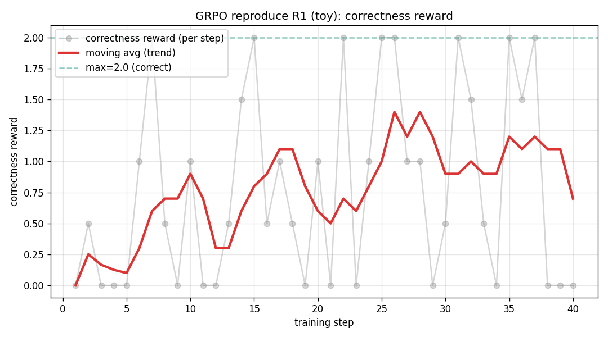

# GRPO＋GSM8K：小模型规则奖励实验

用 TRL GRPOTrainer 和 LoRA 在 Qwen2.5-0.5B-Instruct 上跑通规则奖励训练。个人实验，Apple M4 Pro、24GB、MPS。更新至 2026-10-11，公开训练脚本、Notebook、40步日志与曲线。

## 已保存结果

从 [`reward_log.json`](reward_log.json) 的40个 step 重算：

| 指标 | 前20步均值 | 后20步均值 |
|---|---|---|
| 正确性 reward，答对给2分 | 0.60 | 0.95 |
| 格式 reward，最高0.5分 | 0 | 0.003125 |

这是训练中每步采样组的奖励均值，没有独立测试集准确率结论。格式奖励仍接近0。本次没有执行新的超参消融，原本的 KL、组大小、温度实验卡尚未填写结果。



## 实现与诊断

- 每题生成4个 completion；LoRA r＝8，KL beta＝0.04，temperature＝0.9。
- 正确性奖励优先抽取 `<answer>` 内数字，缺标签时取全文最后一个数字；这恢复了“算对但格式不合规”样本的学习信号。
- 格式奖励分别检查 reasoning、answer 标签，每项0.25分。
- 数字由奖励函数与标准答案核对，标准答案没有拼入模型 prompt。

数字兜底可能误取推理中最后出现的数，因此后续应做独立测试及奖励误判检查。这次小规模结果用于理解 GRPO 的更新信号。

## 运行

```bash
# 只重算保存指标，不加载模型。
python3 examples/summarize_rewards.py
python3 -m pip install -r requirements.txt
# 重跑历史记录的步数；需下载模型和 GSM8K。
N_DATA=300 MAX_STEPS=40 python3 train_grpo.py
```

脚本默认是200题、30步；历史日志为300题、40步，复现时需显式设置。完整训练依赖未锁定，运行前需核验 TRL API 与本机环境。本次验证包含日志重算、奖励函数检查和 Python／Notebook 解析，没有重跑训练。

来源：Qwen2.5、公开 GSM8K、TRL GRPOTrainer；权重和下载数据不随仓库分发。
